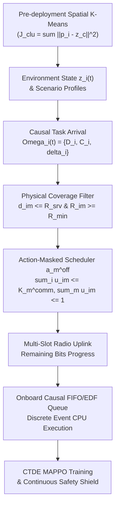

# Instructor Change Audit & Architectural Migration Plan

**Project:** Joint Task Offloading and Adaptive Trajectory Optimization in Trust- and Fault-Aware Multi-UAV Edge IoT Networks  
**Target Journal:** IEEE Internet of Things Journal  
**Author:** Research Software Engineering Team  
**Date:** November 2026  
**Status:** Approved for Implementation (Reversible Git Patch Saved: `backup_pre_supervisor_changes.patch`)

---

## 1. Executive Summary & Purpose

This document provides a rigorous mathematical, algorithmic, and architectural audit of the project codebase following explicit new guidelines issued by the research supervisor. 

The previous version of the codebase implemented:
1. Pre-deployment workload-weighted Lloyd K-Means clustering assuming prior oracle knowledge of device task arrival rates $\lambda_i^0$, data sizes $D_i^0$, and CPU cycles $C_i^0$.
2. Task offloading eligibility tied strictly to cluster assignment membership ($x_{m,c}(t)$) rather than actual geometric and radio coverage ($d_{im}(t) \le R_{\text{srv}}$).
3. Stationary, unconditional Bernoulli task arrivals with fixed average rates across all devices.
4. Uncapped simultaneous communication links per UAV, limited only by aggregate CPU frequency.

The supervisor's directives mandate a migration to:
1. **Environment-Dependent Task Generation:** Sensed regional events, environmental modes (Routine, Hotspot, Emergency, Shift), and explicit application processing profiles—eliminating pre-deployment workload oracle assumptions.
2. **True Geometric & Radio Coverage-Driven Communication:** An IoT device can communicate with a UAV if and only if it is within physical service range ($d_{im}(t) \le R_{m,\text{srv}}$), achieves minimum uplink SNR/rate ($R_{im}(t) \ge R_{\min}$), and the UAV is certificate-authenticated and hardware-available ($e_m(t) = 1$), regardless of pre-deployment cluster labels.
3. **Simultaneous Communication Concurrency Cap ($K_m^{\text{comm}}$):** Enforcing a hard physical limit on active simultaneous uplink radio channels per UAV, orthogonal frequency allocation, and masked priority scheduling.
4. **Reproducible Real-Data Trajectory and Training Plots:** Vector PDF and publication-grade PNG visualizations of learned 2D/3D UAV routes, matched against untrained and early checkpoints, along with verified training reward curves and component reconciliations.

---

## 2. Exact Requested Changes from Supervisor

| # | Topic | Supervisor Instruction | Previous Implementation | Revised Target Implementation |
|---|---|---|---|---|
| **1** | **Task Generation** | Environment-dependent, causal, profile-driven task generation. No generic fixed or invented per-device pre-deployment workloads. | Stationary Bernoulli ($p = 0.7$) with uniform unconditioned draws. | Environmental state $z_i(t)$ with 4 named scenarios (Routine, Hotspot, Multi-event, Persistent Shift). Profiles in `config/event_task_profiles.yaml`. |
| **2** | **Service Coverage** | Devices can only communicate with a UAV if currently within actual 3D service range, with adequate channel quality and UAV eligibility. | Communication allowed based on cluster membership index ($c_i = c_m$). | Dynamic candidate set $\mathcal{I}_{m,\text{cov}}(t) = \{i : d_{im}(t) \le R_{m,\text{srv}} \wedge R_{im}(t) \ge R_{i,\min}\}$. Cluster labels used only for high-level spatial indexing. |
| **3** | **Concurrency Cap** | Limit maximum number of simultaneous communicating IoT devices per timestamp. | Unlimited simultaneous uplinks; bandwidth subdivided across all candidate nodes. | Configurable per-UAV concurrency limit $\sum_i u_{im}(t) \le K_m^{\text{comm}}$, single link per device $\sum_m u_{im}(t) \le 1$, and orthogonal bandwidth allocation $\sum_i u_{im} B_{im} \le B_m$. |
| **4** | **Learned Trajectories** | Plot learned UAV trajectories to inspect whether the model learns meaningful routes. | Generic 2D lines without altitude or matched baseline comparison. | 2D and 3D publication plots with IoT clusters, centroids, coverage radii, chronological waypoints, and matched untrained vs early vs trained comparisons. |
| **5** | **Real Training Curves** | Plot real training reward graphs and scientifically useful metrics. | Cumulative running averages across episodes obscuring convergence. | True per-episode and windowed reward curves, decomposition check ($\sum r_i == r_{\text{total}}$), latency/energy progression, and active links vs $K_m^{\text{comm}}$. |

---

## 3. Modeling Decision Flag: Per-UAV Cap $K_m^{\text{comm}}$ vs Network-Wide Cap

> [!IMPORTANT]
> **Instructor Query:** The supervisor stated *"Max N nodes ek timestamp pe communication kar payega"* without specifying whether $N$ denotes a fleet-wide cap or a per-UAV cap.
>
> **Documented Decision:**
> 1. We adopt **configurable per-UAV cap $K_m^{\text{comm}}$** (default: $K_m^{\text{comm}} = 3$ or $4$ simultaneous uplinks per UAV) as the primary physical radio constraint because radio frequency front-ends and orthogonal sub-bands are managed per UAV transceiver. The symbol $N$ is reserved for the total ground IoT device population ($N = 100$).
> 2. We introduce an optional configuration flag `network_wide_K_comm` (default `None`, or an integer cap $\sum_{m=1}^M \sum_{i=1}^N u_{im}(t) \le K_{\text{net}}$) to support global spectrum regulatory constraints if requested.
> 3. **Status:** Flagged as an explicit engineering modeling decision requiring supervisor confirmation.

---

## 4. Affected Equations, Modules, and Code Entities

### Mathematical Formulation Adjustments:
1. **Spatial Clustering (Eq. 1 & 3 Replacement):**
   $$\min_{\{z_c\}} J_{\text{clu}} = \sum_{c=1}^C \sum_{i \in \mathcal{I}_c} \|p_i - z_c\|^2, \quad z_c = \frac{1}{|\mathcal{I}_c|} \sum_{i \in \mathcal{I}_c} p_i$$
   *(Reverts workload weighting $w_i = 1 + \lambda_w \frac{W_i^0}{W_{\max}}$.)*

2. **Coverage-Driven Communication Set:**
   $$\mathcal{I}_{m,\text{cov}}(t) = \left\{ i \in \{1, \dots, N\} : d_{im}(t) \le R_{m,\text{srv}}, \; R_{im}(t) \ge R_{i,\min}, \; e_m(t) = 1 \right\}$$
   where $d_{im}(t) = \sqrt{\|q_m(t) - p_i\|^2 + H_m(t)^2}$.

3. **Simultaneous Concurrency & Exclusivity Constraints:**
   $$u_{im}(t) \in \{0, 1\}, \quad \sum_{i=1}^N u_{im}(t) \le K_m^{\text{comm}}, \quad \sum_{m=1}^M u_{im}(t) \le 1, \quad \forall i, m, t$$

4. **Multi-Slot Transmission Progress:**
   $$D_i^{\text{rem}}(t + \Delta t) = \max\left(0, \; D_i^{\text{rem}}(t) - R_{im}(t) \cdot \Delta t\right)$$
   Upon $D_i^{\text{rem}} = 0$, task is admitted into UAV $m$ computation queue. If $d_{im}(t) > R_{m,\text{srv}}$ or $e_m(t) = 0$, $u_{im}(t) = 0$ and transmission halts.

---

## 5. File-by-File Modification Mapping

| File Path | Current Status | Planned Refactoring | Reversible Action |
|---|---|---|---|
| `config.py` | Has `LAMBDA_W`, fixed `TASK_GENERATION_PROB`. | Add `K_COMM_DEFAULT = 3`, `NETWORK_WIDE_K_COMM = None`, `R_MIN_UPLINK = 1e5`, remove/deprecate `LAMBDA_W`. | Preserves backward compatibility via defaults. |
| `config/event_task_profiles.yaml` | Does not exist. | Create human-readable YAML with Routine, Hotspot, Emergency, and Shift profiles. | New file. |
| `src/clustering.py` | Contains `WorkloadAwareClusterManager`. | Implement `SpatialClusterManager` (unweighted K-means, K-means++, empty cluster repair, coverage stats). Isolate legacy class as `LegacyWorkloadClusterManager`. | Fully tested in Gate 1. |
| `src/task.py` | Bernoulli task generator with fixed probability. | Add `EnvironmentStateManager`, scenario profiles (A, B, C, D), multi-slot upload bits accounting, deadline tracking. | Unit tested. |
| `src/channel.py` | Point-to-point rate calculations. | Add coverage set evaluator $\mathcal{I}_{m,\text{cov}}$, orthogonal bandwidth distributor for active links $u_{im}$. | Pure mathematical functions. |
| `src/action_mask.py` | Categorical cluster mask and trajectory shield. | Extend mask to generate candidate priority masks respecting $K_m^{\text{comm}}$ and per-node exclusivity. | Action mask dimension updated. |
| `src/actor.py` | 3 heads: cluster, movement, CPU. | Factorized 4-head actor: $a_m^{\text{clu}}$ (region target), $a_m^{\text{off}}$ (offloading candidate priority logits), $a_m^{\text{cpu}}$, $a_m^{\text{mov}}$. | Clean PPO ratio calculation. |
| `src/env.py` | Maps communication by cluster index $c_i == c_m$. | Complete rewrite of communication step: coverage filter, candidate selection, $K_m^{\text{comm}}$ enforcement, multi-slot progress. | Core environment upgrade. |
| `tests/test_supervisor_acceptance.py` | Does not exist. | Implement 12 comprehensive acceptance tests required by Phase 6. | New deterministic test suite. |
| `scripts/generate_paper_plots.py` | Generates 10 baseline figures. | Add real trajectory comparison (matched untrained vs early vs trained) and real training reward curves with components. | Visual verification. |

---

## 6. Risks, Rollback Plan, and Non-Regressions

1. **Rollback Guarantee:**
   A complete git patch of the working state has been created at `backup_pre_supervisor_changes.patch`. All previous results are preserved under `results/legacy_pre_change/` and `outputs/legacy_pre_change/`.
2. **Preserved Non-Regressions:**
   - 3D rotary-wing aerodynamics power model ($P(v)$ bathtub curve).
   - LoS / NLoS path loss model with excess attenuation.
   - Continuous-time pairwise UAV trajectory safety shield.
   - Dual-state certificate authentication $\tau_m(t)$ and hardware fault availability $\phi_m(t)$.
   - CTDE MAPPO architecture with centralized critic and decentralized actors.

